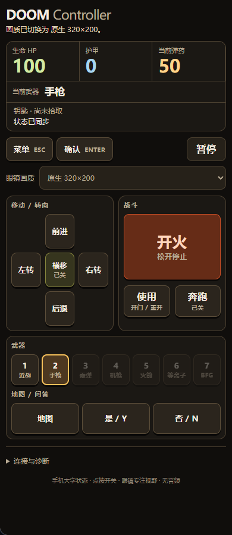

# DOOM Controller for MemoMind

[中文说明](README.zh-CN.md)

Play DOOM on MemoMind glasses. Your phone runs the game and acts as the touch controller. The glasses show the game view. A large **Phone HUD** shows health, armor, ammo, weapons, and keys.

Version **0.1.5** includes the complete **Freedoom Phase 1 0.11.3** game data. Commercial DOOM and DOOM II game data are not included. This is a community project, independent of MemoMind and id Software.



*Phone HUD in Browser Studio. This screenshot is a simulation, not a photo through the glasses.*

## Play on your glasses

You need a phone with the MemoMind App, compatible MemoMind glasses, and the **GM Web Bridge** glasses plugin. To build and install this source release, you also need the MemoMind SDK and Desktop Studio from the [developer platform](https://open-platform.memo-mind.com/).

This repository contains the game source, generated game engines, and Freedoom data. Obtain the SDK, Studio, and GM Web Bridge separately. A phone package and a live installation QR code are not included here.

Follow [Build and preview](docs/BUILD.md), then [Install on a phone and glasses](docs/INSTALL.md). These guides are in Chinese. The phone package alone does not install the glasses plugin; use Studio to prepare a **paired installation package**.

When the game opens, tap **菜单 / Menu**, then **确认 / Confirm** to select a new game, episode, and difficulty. Use the direction buttons to move through menus.

| Control | Action |
| --- | --- |
| Direction buttons | Hold to move or turn. Release to stop. |
| 开火 / Fire | Hold to shoot. Release to stop. |
| 横移 / Strafe | Tap to switch on. Left and right now move sideways. Tap again to switch off. |
| 奔跑 / Run | Tap to switch on or off. |
| 使用 / Use | Open a door or restart after death. |
| Weapon buttons | Select a weapon you own. |
| 暂停 / Pause | Stop the game. Tap Continue to resume. |

Strafe and Run stay on without holding a second button. Fire always stops when you release it. If the page loses focus, becomes hidden, or the glasses disconnect, inputs are released and the game pauses. Resume when you are ready.

The Phone HUD reads the game state and updates about four times per second. **Smooth mode** is the default. It uses less image detail while keeping the full field of view. Native and full-screen quality modes are also available.

## Try the source

Use **Node.js 20 or later**. Open a terminal in the repository directory:

```sh
npm ci
npm test
npm run verify:assets
```

These checks run the real game engines and verify the bundled game data. They do not need the MemoMind SDK, glasses, Python, or a C compiler.

To preview the phone controller, obtain the external MemoMind SDK and set `MEMOMIND_SDK_ROOT` to its root directory:

```powershell
# PowerShell: replace this path with your SDK directory.
$env:MEMOMIND_SDK_ROOT = 'D:/development/plugin-open-platform'
npm run build
npm run preview
```

For a POSIX shell, use `export MEMOMIND_SDK_ROOT=/path/to/plugin-open-platform`. Open the local address printed by the preview command. Preview uses Browser Studio; it does not test the physical glasses.

See [the build guide](docs/BUILD.md) for browser tests, phone packaging, asset downloads, and engine rebuilds. Python 3 is needed to download the assets again. Emscripten 3.1.74 is needed to rebuild the C engine. Both generated game engines are already included.

## Current limits

- No audio, game-progress save/load interface, PWAD mods, or multiplayer.
- You can import a legally obtained IWAD up to 32 MiB. The app can keep a file reference, not your game progress.
- Glasses refresh depends on the connection, host, and scene. Completed display frames count app transfers; they do not measure physical panel refresh.

The accepted game version has user feedback from a phone and glasses. The public source build has local engine and browser checks. See [Validation](docs/VALIDATION.md) for what was tested and what still needs a device check.

## Learn more

| Guide | What it covers |
| --- | --- |
| [User guide](docs/USER_GUIDE.md) | Controls, Phone HUD, game data, and quality modes |
| [Architecture](docs/ARCHITECTURE.md) | How the phone, game engine, and glasses work together |
| [Sources and licenses](docs/SOURCES.md) | Upstream versions, data hashes, and platform dependencies |
| [Project terms](GLOSSARY.md) and [decisions](docs/decisions/README.md) | Shared terms and the reasons behind the design |
| [Changelog](CHANGELOG.md) | Changes through 0.1.5 |
| [Contributing](CONTRIBUTING.md) | How to prepare a change and report a problem |

The detailed guides are currently in Chinese.

## License

The application and engine use **GPL-2.0-or-later**. Freedoom data uses **BSD-3-Clause**. fflate uses **MIT**. See [LICENSE](LICENSE) and [third-party notices](THIRD_PARTY_NOTICES.md) for the full notices and component boundaries.

MemoMind components have separate terms. They are external dependencies and are not covered by this project's GPL license. Check their distribution terms before you publish a package that includes them. DOOM and MemoMind names belong to their respective owners.
