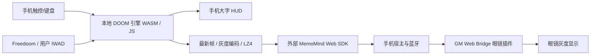

# 架构与契约

`engine/doomgeneric_memomind.c` 提供帧、调色板、输入队列及真实玩家状态导出。`engine-core.js` 驱动 35 Hz 游戏逻辑，`engine-client.js` 和 worker 分离计算；不支持 WASM / Worker 时保留主线程 JS 回退。35 Hz 是游戏逻辑频率，不是眼镜刷新承诺。

`controller.js` 管理按压按钮和横移/奔跑开关；`hud.js` 显示约 250 ms 采样的生命、护甲、弹药、拥有武器和钥匙。HUD 不识别画面文字，也不产生额外蓝牙 HUD 消息。

`frame-codec.js` 从调色板映射到 GRAY4；流畅模式 160×100 采样后放大到 320×200。`glass-display.js` 和主线程各保留最新待发送帧，不积累历史画面；仅一帧发送在途，能力不足时回退无压缩 GRAY4。丢弃过时待发帧属于保持时效的调度行为，诊断“丢帧”不等同于蓝牙传输失败。

应用声明 Bridge v2，显示、连接事件必需；文件与存储可选，无网络权限。依赖协议 `gm.scene`、`gm.scene-lz4`、`gm.scene-atomic-frame`、`gm.device-events` 均为最小 1.0。眼镜原显示协议保持不变，手机本地计算后发送图像。

先调用 `gm.ready()`，再初始化权限和设备状态。断连、隐藏、失焦、暂停和销毁释放输入、关闭模式开关；恢复连接后同步完整帧并等待手动继续。存储只保存用户所选文件引用。

源码地图：`src/plugin.js` 为页面入口；`wad.js` 解压/校验 IWAD；`engine-loader.js` 选后端；`lz4.js` 为压缩实现。上游引擎的三个修改文件和差异见 [SOURCES.md](SOURCES.md)。
